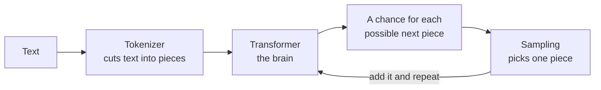
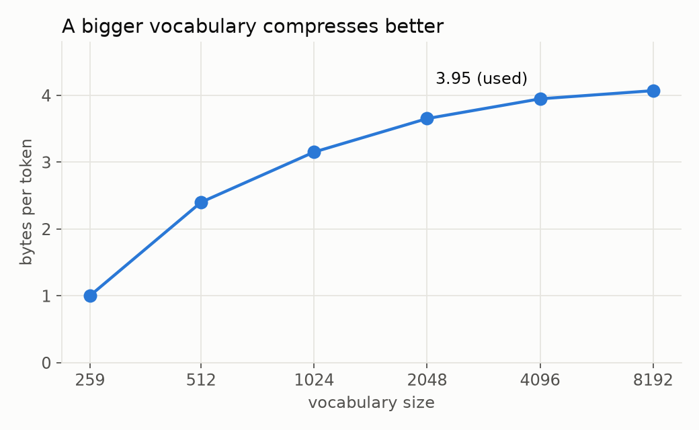

# tinylm-from-scratch

<!-- VIDEO: record `uv run python -m scripts.make_demo --play`, drag the .mp4 into the GitHub editor,
     then replace the GIF line below with the URL that GitHub gives you. -->


> *I built a small language model from zero (its tokenizer, its brain, its training), then taught it
> to follow instructions, and measured every step.*

## The problem

Chatbots can look like magic, so I built a very small one myself to understand every step.

## What I built

1. I built a small program that learns to write by reading children's stories.
2. I taught it to follow one kind of order: *"Write a story that uses the words: hug, bin, delicious"*.
3. I then showed it good and bad answers, so that it learned to prefer the good ones.

## Does it work?

**Yes, for this small task.** It went from random noise to simple English stories.


The blue line is the model's error on stories it did not train on. Lower is better.

Then I gave it 2,000 orders it had never seen. A small program checked each answer: are the three
words there, and is it a real, finished story?

| The model, after... | Orders followed |
|---|---:|
| reading stories (base) | **0.05%** |
| practising with examples (SFT) | **30.0%** |
| learning what is preferred (DPO) | **73.0%** |

The first score is low by design: at that point the model had never seen an order.

The last model is far from perfect. It often puts the right words in a story that makes little sense.

## How it works



The brain learns in three stages:


---

## Under the hood

Everything below is for readers who know machine learning. Every result comes from a run saved in
[`results/`](results).

### Architecture

The code is pure PyTorch and NumPy.

| Component | Choice | Why |
|---|---|---|
| Tokenizer | own byte-level BPE, 4,096 tokens | encodes any string, with short sequences |
| Embedding | 256 dimensions, tied to the output head | saves 15% of the parameters |
| Body | 6 pre-norm blocks, 8 heads, context of 256 | the residual path stays an identity |
| Attention | hand-written, causal | every step is visible |
| Positions | RoPE | no parameters, scores depend on distance |
| Norm | RMSNorm | simpler than LayerNorm, standard in modern LLMs |
| MLP | SwiGLU, hidden size 704 | standard gated MLP |
| Left out | dropout, biases, fancy init, AMP | not needed at this scale |

```
parameters = V·d + L·(4d² + 3·d·f + 2d) + d = 5,868,800
```

### Training and compute

| | Pre-training | SFT | DPO |
|---|---|---|---|
| Data | GPT-4 part of TinyStories | instruction + story pairs | 3,750 pairs sampled from the SFT model |
| Loss | next-token cross-entropy | the same, on the answer only | DPO, β = 0.1 |
| Optimizer | AdamW, lr 1e-3 | AdamW, lr 3e-4 | AdamW, lr 1e-5 |
| Length | 20,000 steps | 4,000 steps | 234 steps (best epoch) |
| Tokens seen | 327.7M | 65.5M, padding included | n/a |
| Time, evaluations included | 4 h 45 min | 62 min | not logged |

All of it ran on a fanless MacBook Air M4 (MPS), with no paid compute. By the 6·N·D rule,
pre-training is about 1.15e16 FLOPs, with about 56 tokens seen per parameter.

Validation loss went from 8.368 to 1.399 (perplexity 4.05). The training loss ended at 1.380.

### Evaluation on held-out instructions

| Test, 2,000 instructions | Base | SFT | DPO |
|---|---:|---:|---:|
| **Success (all checks pass)** | 0.05% ± 0.1 | 30.0% ± 2.0 | **73.0% ± 1.9** |
| All three exact words | 0.05% | 31.4% | 83.0% |
| Words found, out of 3 | 0.32 | 2.09 | 2.82 |
| Proper ending | 81.2% | 98.0% | 96.0% |
| At least 50 words | 98.0% | 100% | 100% |
| Not repetitive | 99.8% | 99.95% | 99.3% |
| Words not just listed together | 100% | 99.0% | 93.5% |
| Bits per byte on free stories (lower is better) | 0.420 | 0.444 | 0.446 |

Intervals are 95%. On the same instructions, DPO gains 43.0 ± 2.6 points over SFT.

- The split is by word triplet and was made before any training.
- SFT references were filtered with the same checks.
- The DPO epoch and learning rate were chosen on validation.
- Bits per byte is the total loss in bits divided by the bytes of the text. Unlike perplexity, it
  does not depend on the size of the tokens, so different tokenizers can be compared.

### Tokenizer



### KV-cache


| Tokens per second, 256 tokens generated | With cache | Without | Gain |
|---|---:|---:|---:|
| CPU | 904 | 153 | **5.9×** |
| GPU (MPS) | 221 | 139 | **1.6×** |

For one story at a time the CPU is about 4 times faster than the GPU: with such a small model, starting
each GPU operation costs more than the maths itself. For 16 tokens the cache gives no gain on the GPU
(194 against 210 tokens/s), a short measurement that is also noisy. The laptop was on battery, with low
power mode off.


```
cache = 2 · layers · heads · head_dim · length · bytes · batch
      = 2 · 6 · 8 · 32 · 256 · 4 · 1 = 3 MiB per story
```

### Ablations


Small models (128 dimensions, 4 layers, 4 heads), 1,500 steps and 24.6M tokens each, 3 seeds per
variant. Test bits per byte, lower is better:

| Variant | Parameters | Bits per byte (mean ± std) | Against the reference |
|---|---:|---:|---:|
| RoPE, 4,096 tokens (reference) | 1,279,104 | **0.640 ± 0.005** | |
| Learned positions | 1,311,872 | 0.674 ± 0.005 | 5.3% worse |
| RoPE, 1,024 tokens | 885,888 | 0.714 ± 0.005 | 11.6% worse |

Both gaps are much larger than the spread between seeds. The vocabulary test is not a pure comparison:
at equal tokens, the 1,024 model has fewer parameters and also reads about 20% less text, as its
tokens are shorter. It also shows why perplexity misleads: its perplexity is *better* (about 4.9
against 5.7) while it is the *worse* model.

## What failed and what I learned

- **The checker can be gamed.** DPO learned what I measure, which is the words, and not what I want,
  which is a good story. One passing story says *"Let's load my chess pieces with chess pieces."*
  After DPO, 6.5% of the stories squeeze the three words into six consecutive words, against 1.0%
  after SFT. A guard counts those as failures, but no guard here checks meaning.
- **More DPO was worse.** On validation, success peaked at 73.6% after one epoch and fell to 64.3%
  after four. With a 5 times higher learning rate it fell to 46.2%: stories grew longer and only
  57.4% of them still ended properly. Choosing the epoch on validation saved the result.
- **SFT alone was not enough.** It placed about 70% of the words, but an order needs all three, so
  70% of the orders still failed.
- **Fine-tuning made it forget a little.** On free stories the code length is 5.7% worse after SFT
  and 6.1% worse after DPO than after pre-training.
- **The demo is not cherry-picked.** With the seed fixed in advance, the SFT story finds none of the
  three words ("hugged" does not count as "hug"). The DPO story passes, and it is about a girl who
  hugs her bin.
- **A GPU is not always faster.** To generate one story with this small model, the CPU won.
- **One seed for the main model.** Only the ablations were repeated. The intervals above cover the
  test instructions, not the randomness of training.

## Run it

```bash
git clone https://github.com/ALI-AL-MARJANI/tinylm-from-scratch.git && cd tinylm-from-scratch
uv sync
uv run python -m scripts.make_demo --play
```

This replays the saved demo in your terminal. It needs [uv](https://docs.astral.sh/uv/) and no GPU.

<details>
<summary>Train everything again (pre-training and SFT alone took 5 h 47 min on a MacBook Air M4)</summary>

```bash
uv run pytest -q

# data and tokenizers (about 2 GB on disk)
uv run python -m scripts.prepare_data --vocab 4096
uv run python -m scripts.prepare_data --vocab 1024
uv run python -m scripts.prepare_data --compression

# pre-training, SFT, DPO
uv run python -m tinylm.train --name base
uv run python -m tinylm.train --name sft --stage sft --init checkpoints/base/step_20000.pt \
  --steps 4000 --lr 3e-4 --warmup 200 --eval_every 500 --save_at ""
mkdir -p checkpoints/dpo && cp checkpoints/sft/step_4000.pt checkpoints/sft/final.pt
for lr in 1e-5 5e-5; do
  uv run python -m tinylm.post_train --init checkpoints/sft/final.pt --name dpo_lr$lr --lr $lr
done
# 1e-5 had the best validation success
cp checkpoints/dpo_lr1e-5/best.pt checkpoints/dpo/final.pt
cp results/dpo_lr1e-5.json results/dpo.json

# evaluation
evaluate() {
  uv run python -m tinylm.eval bpb --ckpt "$2" --out "results/bpb_$1.json"
  uv run python -m tinylm.eval follow --ckpt "$2" --out "results/follow_$1.json"
}
evaluate base checkpoints/base/step_20000.pt
evaluate sft checkpoints/sft/final.pt
evaluate dpo checkpoints/dpo/final.pt
for device in mps cpu; do
  uv run python -m tinylm.eval speed --device $device --ckpt checkpoints/base/step_20000.pt \
    --out results/speed_$device.json
done

# ablations
ablation() {
  name=$1; shift
  uv run python -m tinylm.train --name "$name" "$@" --d_model 128 --n_layers 4 --n_heads 4 \
    --d_ff 320 --steps 1500 --lr 2e-3 --warmup 150 --eval_every 250 --save_at ""
  uv run python -m tinylm.eval bpb --ckpt "checkpoints/$name/step_1500.pt" --out "results/bpb_$name.json"
}
for seed in 0 1 2; do
  ablation abl_rope_s$seed --seed $seed --pos rope
  ablation abl_learned_s$seed --seed $seed --pos learned
  ablation abl_v1024_s$seed --seed $seed --data data/v1024
done

# demo and figures
uv run python -m scripts.make_demo
uv run python -m scripts.plot
```

On a machine without Apple Silicon, replace `mps` by `cuda`, or keep only `cpu`.
[`notebooks/colab_train.ipynb`](notebooks/colab_train.ipynb) wraps the main training for Colab. I trained
on the Mac, so that notebook has not been run on Colab.

</details>

## Credits

- Data: [TinyStories](https://huggingface.co/datasets/roneneldan/TinyStories) by Ronen Eldan and
  Yuanzhi Li ([paper](https://arxiv.org/abs/2305.07759)), license CDLA-Sharing-1.0.
- Ideas: [minbpe](https://github.com/karpathy/minbpe), [nanoGPT](https://github.com/karpathy/nanoGPT),
  [nanochat](https://github.com/karpathy/nanochat), [Stanford CS336](https://cs336.stanford.edu/),
  [RoPE](https://arxiv.org/abs/2104.09864), [DPO](https://arxiv.org/abs/2305.18290).
