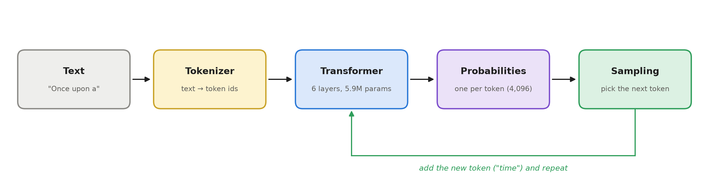
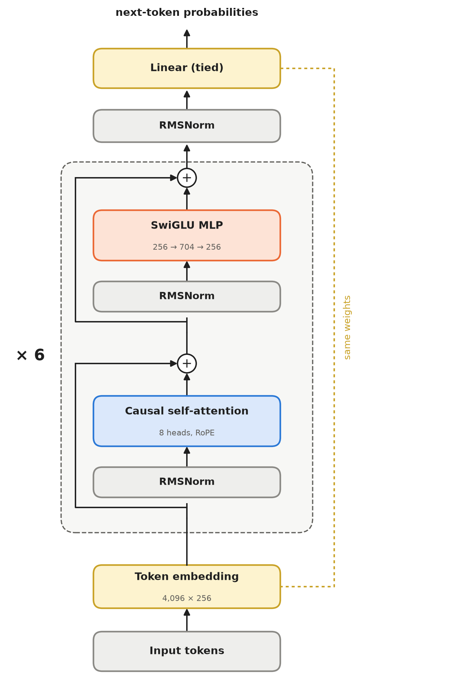
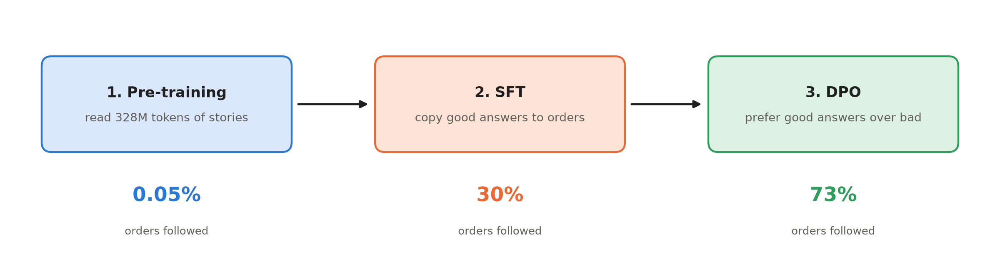
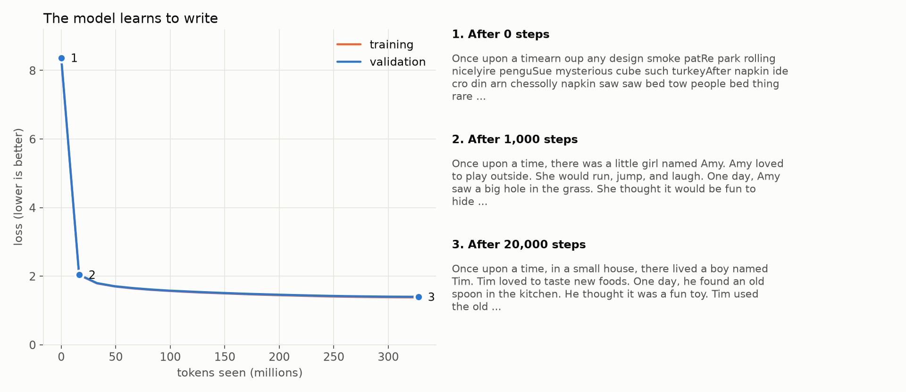
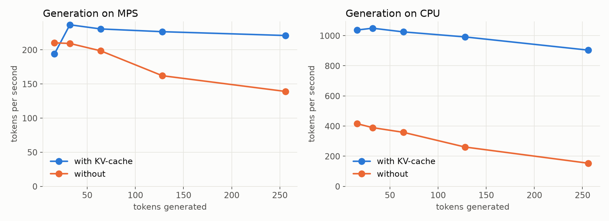
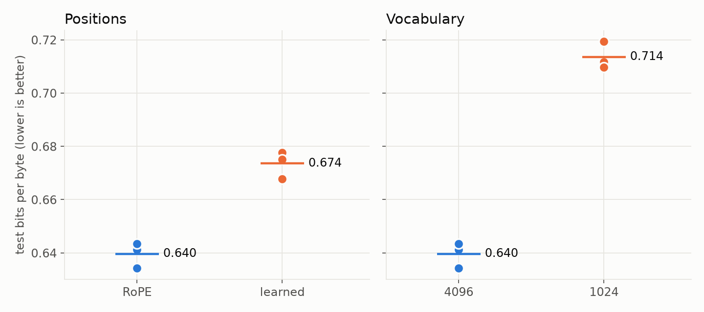

# TinyLm-from-scratch

### I built a small language model from zero: the tokenizer, the model and the training. Then I taught it to follow simple orders, and measured each step.


## How it works

The model writes one token at a time. It looks at the text so far, gives a probability to each
possible next token, picks one, and starts again.



The model is a small decoder in the style of Llama: 6 blocks of attention and MLP, with a residual
path around each part.

<p align="center">
  
</p>

It learns in three stages:



The order is always the same type: *"Write a story that uses the words: hug, bin, delicious"*.

## Results

The model learns to write simple English stories. The blue line is the error on stories not seen
in training (lower is better).



A test used 2,000 new orders. A small program checks each answer: are the three words there, and
is it a real, finished story?

| Stage | Orders followed | Words found (out of 3) |
|---|---:|---:|
| Pre-training | 0.05% | 0.32 |
| SFT | 30.0% ± 2.0 | 2.09 |
| DPO | **73.0% ± 1.9** | 2.82 |

The first score is low on purpose: at that point the model has never seen an order. On the same
orders, DPO gains 43.0 ± 2.6 points over SFT. The test orders were split away before any training.

## Details

| | Pre-training | SFT | DPO |
|---|---|---|---|
| Data | TinyStories (GPT-4 part) | order + story pairs | 3,750 good/bad pairs |
| Steps | 20,000 | 4,000 | 234 |
| Learning rate | 1e-3 | 3e-4 | 1e-5 |
| Time | 4 h 45 min | 62 min | not logged |

- **Tokenizer:** byte-level BPE, 4,096 tokens, written from scratch.
- **Model:** 256 dimensions, 8 heads, context of 256, RoPE, RMSNorm, SwiGLU, tied input and output weights.
- **Pre-training:** 328M tokens. The validation loss goes from 8.37 to 1.40.

**KV-cache.** Keeping the past keys and values makes generation 5.9× faster on CPU and 1.6× on the
GPU (MPS). For one story, the CPU is 4× faster than the GPU: the model is so small that launching
GPU work costs more than the maths.



**Ablations.** Small models, 3 seeds each, measured in bits per byte (lower is better):

| Variant | Bits per byte | vs. reference |
|---|---:|---:|
| RoPE, 4,096 tokens (reference) | **0.640 ± 0.005** | |
| Learned positions | 0.674 ± 0.005 | 5.3% worse |
| RoPE, 1,024 tokens | 0.714 ± 0.005 | 11.6% worse |

Both gaps are much bigger than the noise between seeds. The smaller vocabulary has a *better*
perplexity but is the *worse* model, which shows why bits per byte is the fair measure.



## Limits

- **The checker can be fooled.** It checks the words, not the meaning. One passing story says
  *"Let's load my chess pieces with chess pieces."*
- **Too much DPO hurts.** Success peaked after one epoch (73.6% on validation) and fell to 64.3%
  after four. The best epoch was picked on validation.
- **Fine-tuning costs a little.** On free stories, the model is about 6% worse after SFT and DPO.
- **One seed for the main model.** Only the ablations were repeated.

## Run it

```bash
git clone https://github.com/ALI-AL-MARJANI/tinylm-from-scratch.git && cd tinylm-from-scratch
uv sync
uv run python -m scripts.make_demo --play
```

This replays the saved demo in the terminal. It needs [uv](https://docs.astral.sh/uv/) and no GPU.

<details>
<summary>Train everything again (about 6 hours on a MacBook Air M4)</summary>

```bash
uv run pytest -q
uv run python -m scripts.prepare_data --vocab 4096

uv run python -m tinylm.train --name base
uv run python -m tinylm.train --name sft --stage sft --init checkpoints/base/step_20000.pt \
  --steps 4000 --lr 3e-4 --warmup 200 --eval_every 500 --save_at ""
cp checkpoints/sft/step_4000.pt checkpoints/sft/final.pt
uv run python -m tinylm.post_train --init checkpoints/sft/final.pt --name dpo_lr1e-5 --lr 1e-5
mkdir -p checkpoints/dpo && cp checkpoints/dpo_lr1e-5/best.pt checkpoints/dpo/final.pt

uv run python -m tinylm.eval follow --ckpt checkpoints/dpo/final.pt --out results/follow_dpo.json
uv run python -m tinylm.generate --ckpt checkpoints/dpo/final.pt --words "dog, run, happy"

uv run python -m scripts.plot
uv run python -m scripts.diagrams
```

On a machine without Apple Silicon, the code uses `cuda` or `cpu`.
[`notebooks/colab_train.ipynb`](notebooks/colab_train.ipynb) wraps the main training for Colab
(not tested on Colab).

</details>

## Credits

- Data: [TinyStories](https://huggingface.co/datasets/roneneldan/TinyStories)
- Ideas: [nanoGPT](https://github.com/karpathy/nanoGPT),
  [nanochat](https://github.com/karpathy/nanochat)

